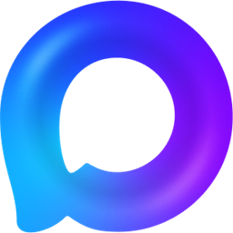
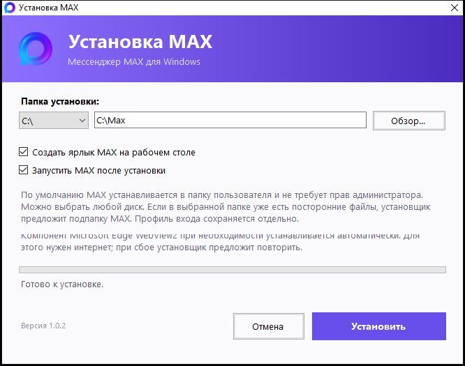

# MAX для Windows — приложение для web.max.ru

**Скачать установщик:** [релиз 1.0.2](https://github.com/Hyndex322/max-web-desktop/releases/tag/v1.0.2) · **Файл:** `MaxSetup.exe`

> ℹ️ **Статус 1.0.2:** сборка опубликована как тестовая, потому что доверенный сертификат подписи кода пока не предоставлен. Подпись и метка времени присутствуют, но SmartScreen может предупреждать. Подробности — в разделе «Подпись релиза» и в `SIGNATURE-STATUS.txt`.

Это небольшое неофициальное Windows-приложение, которое открывает **https://web.max.ru** в отдельном окне. Внутри работает тот же сайт MAX, но без адресной строки, вкладок и остального интерфейса браузера. Вход выполняется один раз — сессия сохраняется.

> ⚠️ **Это не официальный клиент MAX.** Проект не связан с MAX/VK. Название и логотип MAX принадлежат их правообладателям. Приложение лишь открывает официальный сайт `web.max.ru` в отдельном окне.





## Что нового в 1.0.2

- Новая цветная иконка MAX во всех компонентах: `Max.exe`, `MaxSetup.exe`, ярлыки, установщик и документация.
- Улучшена обработка отказа от UAC: установка и удаление не выполняются молча, пользователь видит понятный результат и может повторить действие.
- Действия горячих клавиш записываются в журнал для диагностики (без текста страницы и полных URL).
- Добавлен `SIGNATURE-STATUS.txt`: статус подписи `Max.exe` и `MaxSetup.exe`, наличие метки времени и признак доверия Windows.
- Добавлен режим сборки `-RequireTrustedSignature`, который останавливает выпуск, если подпись не доверена Windows.
- Обновлены протокол приёмки и инструкция установки для версии 1.0.2.
- Сохранены все исправления 1.0.1: безопасное обновление с откатом, манифест файлов, защита от junction-ссылок, сохранение профиля по умолчанию, политика WebView2.

Полный протокол проверок: [docs/ACCEPTANCE.md](docs/ACCEPTANCE.md).

## Возможности

- Открывает `web.max.ru` в отдельном окне без адресной строки и вкладок.
- Сохраняет сессию входа: после первого входа по QR-коду или номеру телефона повторно входить не нужно.
- Поддерживает камеру, микрофон, уведомления и буфер обмена для MAX. Для камеры и микрофона показывается стандартный запрос согласия.
- Ссылки на другие сайты открывает в системном браузере только по нажатию пользователя; автоматические переходы и редиректы блокируются.
- Не запускает второй экземпляр: повторный запуск активирует уже открытое окно.
- Запоминает размер и положение окна, поддерживает тёмную тему.
- Горячие клавиши: `F5`/`Ctrl+R`, `F11`, `Alt+←/→`, `Ctrl+±/0`.
- При ошибке загрузки показывает понятный экран с кнопкой «Повторить» и ссылкой на журнал.

## Установщик

Один файл `MaxSetup.exe`, ничего дополнительно скачивать не нужно:

- установка в `%LOCALAPPDATA%\Programs\MAX` по умолчанию (без прав администратора);
- можно выбрать **любой диск** (`D:\MAX`, `E:\MAX`) или любую папку;
- если в выбранной папке уже есть посторонние файлы, установщик предложит подпапку `MAX` или другой путь;
- ярлык **MAX на рабочем столе** и в меню «Пуск»;
- запись в «Приложениях» Windows для удаления;
- `Uninstall.exe` в папке установки;
- автоматическая установка компонента **Microsoft Edge WebView2**, если его нет;
- обновление поверх старой версии с сохранением сессии.

### Обновление

При обновлении заменяются только файлы приложения. Предыдущая версия сохраняется во временной папке до успешного завершения. Если замена не удалась, установщик восстанавливает предыдущую версию. Посторонние файлы в папке установки не затрагиваются.

Перед заменой файлов установщик корректно закрывает только `Max.exe` из выбранной папки. Сторонняя программа с именем процесса `Max` не закрывается.

### Удаление

- удаляются только файлы из списка установки, ярлыки MAX и запись в реестре;
- посторонние файлы и папки сохраняются;
- папка установки удаляется только если после удаления она пуста;
- операции удаления не выходят за пределы папки установки, в том числе через символические ссылки и точки соединения;
- **профиль WebView2 по умолчанию сохраняется**;
- для удаления сохранённого входа нужно явно поставить флажок «Удалить также сохранённый профиль WebView2»;
- выбранный вариант профиля передаётся и при повторном запуске удаления с правами администратора.

## Системные требования

- Windows 10 или Windows 11.
- .NET Framework 4.8 — входит в состав Windows 10/11.
- Microsoft Edge WebView2 Runtime — устанавливается установщиком при наличии интернета.
- Интернет для первого входа.

Архитектуры:

| Архитектура | Состояние в 1.0.2 |
|---|---|
| x64 | проверено на Windows 10 21H2 (19044) |
| x86 | компоненты включены; отдельная приёмка не проводилась |
| ARM64 | компоненты включены; отдельная приёмка не проводилась |

Сборка содержит загрузчики WebView2 для x86, x64 и ARM64. Для x86 и ARM64 нужна отдельная проверка на соответствующей системе.

## Установка

1. Скачайте `MaxSetup.exe` из [релиза 1.0.2](https://github.com/Hyndex322/max-web-desktop/releases/tag/v1.0.2).
2. Запустите файл.
3. Выберите диск/папку и нажмите «Установить».
4. Дождитесь завершения — на рабочем столе появится ярлык **MAX**.

Если Windows SmartScreen предупреждает о неизвестном издателе: «Подробнее» → «Выполнить в любом случае». Релиз 1.0.2 подписан самоподписанным сертификатом издателя (см. ниже), который не входит в доверенные корневые сертификаты Windows.

Проверить целостность файла можно по `SHA256.txt` из релиза:

```powershell
Get-FileHash .\MaxSetup.exe -Algorithm SHA256
```

## Подпись релиза

В 1.0.2 `Max.exe` подписывается **до** упаковки в установщик, затем подписывается готовый `MaxSetup.exe`. Для обеих подписей используется Authenticode с меткой времени. Публичный сертификат издателя прилагается: `MAX-Publisher.cer`.

Текущая сборка 1.0.2 подписана **самоподписанным** сертификатом: подпись криптографически действительна и содержит метку времени, но Windows SmartScreen не считает издателя доверенным. Поэтому релиз 1.0.2 помечен как тестовый. Для финального релиза нужен сертификат доверенного центра сертификации (OV/EV Code Signing).

Статус подписи публикуется в `SIGNATURE-STATUS.txt`. Сборка с `-RequireTrustedSignature` завершается ошибкой, если `Get-AuthenticodeSignature` не возвращает `Valid` для обоих файлов. Скрипт `scripts/sign-release.ps1` поддерживает PFX, отпечаток сертификата и самоподписанный режим.

Деинсталлятор является копией подписанного установщика, поэтому сохраняет действительную подпись.

## Первый вход и сохранение сессии

При первом запуске открывается страница `web.max.ru`. Войдите удобным способом — по QR-коду или по номеру телефона.

Сессия и настройки хранятся в:

```
%LOCALAPPDATA%\MAX Messenger\WebView2
```

При следующих запусках вход не требуется. Данные не отправляются никуда, кроме самого сайта MAX.

## Навигация и разрешения

В основном окне разрешены только явно перечисленные HTTPS-источники:

- `https://web.max.ru`
- `https://max.ru`
- `https://www.max.ru`

Проверка выполняется при обычном переходе, редиректе и запросе нового окна. Сторонние HTTP(S)-ссылки открываются в системном браузере только по явному действию пользователя. Автоматические переходы и редиректы на сторонние сайты блокируются. Для специальных схем разрешены только `mailto:` и `tel:`; `file:`, `javascript:`, `data:`, `vbscript:` и `ms-*` блокируются.

Разрешения WebView2 привязаны к точному источнику `https://web.max.ru`:

| Разрешение | Политика |
|---|---|
| Камера, микрофон | стандартный диалог согласия пользователя |
| Уведомления | стандартный диалог согласия пользователя |
| Чтение буфера обмена | разрешено для вставки кода подтверждения |
| Геолокация, файлы, датчики, MIDI, автовоспроизведение и остальные | запрещено |

Инструменты разработчика, автосохранение паролей и доступ веб-страницы к объектам приложения отключены.

## Горячие клавиши

| Клавиши | Действие |
|---|---|
| `F5` или `Ctrl+R` | Обновить страницу |
| `F11` | Полноэкранный режим (`Esc` — выйти) |
| `Alt+←` / `Alt+→` | Назад / вперёд |
| `Ctrl++` / `Ctrl+-` | Увеличить / уменьшить масштаб |
| `Ctrl+0` | Обычный масштаб |

Горячие клавиши обрабатываются и при фокусе внутри WebView2.

## Где хранятся данные

| Что | Где |
|---|---|
| Сессия и настройки | `%LOCALAPPDATA%\MAX Messenger\WebView2` |
| Журнал приложения | `%LOCALAPPDATA%\MAX Messenger\logs\app.log` |
| Журнал установки | `%TEMP%\MAX-Setup.log` |
| Файлы программы | `%LOCALAPPDATA%\Programs\MAX` (или выбранная папка) |

В журналах нет полных URL, query-параметров и полных локальных путей. Для диагностики сохраняются тип события, код ошибки и домен.

## Удаление

Способ 1: **Параметры Windows → Приложения → MAX Messenger → Удалить**.

Способ 2: запустить `Uninstall.exe` из папки установки.

При удалении профиль входа по умолчанию сохраняется. Чтобы удалить сохранённый вход, поставьте флажок «Удалить также сохранённый профиль WebView2» — после этого потребуется авторизоваться заново.

## Сборка из исходников

Нужны Windows 10/11, .NET Framework 4.8, PowerShell 5.1 и интернет для загрузки инструментов.

```powershell
# 1. Скачать WebView2 SDK, компилятор Roslyn и загрузчик WebView2
powershell -ExecutionPolicy Bypass -File .\bootstrap-tools.ps1

# 2. Собрать приложение и установщик
powershell -ExecutionPolicy Bypass -File .\build.ps1

# 3. Собрать с самоподписанной подписью (для локальной проверки)
powershell -ExecutionPolicy Bypass -File .\build.ps1 -SelfSign

# 4. Или подписать сертификатом издателя и требовать доверенную подпись
powershell -ExecutionPolicy Bypass -File .\build.ps1 `
  -CertificatePath .\publisher.pfx -CertificatePassword 'пароль' `
  -RequireTrustedSignature
```

Для финального релиза используйте `-RequireTrustedSignature`: сборка остановится, если `Get-AuthenticodeSignature` не вернёт `Valid` для `Max.exe` и `MaxSetup.exe`.

Готовый установщик появится в `dist\MaxSetup.exe`, там же создаются `SHA256.txt`, `SIGNATURE-STATUS.txt`, `MAX-1.0.2-sources.zip` и (при подписи) `MAX-Publisher.cer`.

`build.ps1` сам вызывает `bootstrap-tools.ps1`, если инструментов нет.

Закреплённые версии зависимостей:

- Microsoft.Web.WebView2 SDK — `1.0.4314.35`;
- Microsoft.NET.Compilers.Toolset (Roslyn) — `5.12.0`;
- Microsoft Edge WebView2 Evergreen Bootstrapper — актуальная версия на момент сборки, подпись Microsoft проверяется при каждом запуске.

### Структура проекта

```
src/app/            приложение WinForms + WebView2
src/installer/      установщик, обновление и удаление
src/common/         общая очистка журналов
src/tools/          конвертация изображений в .ico
scripts/            подпись, архив исходников, публикация релиза
ico/                финальные иконки
assets/             README для установки и резервная иконка
dist/               собранный MaxSetup.exe, SHA256.txt, архив исходников
docs/               скриншоты и протокол приёмки
build.ps1           сборка приложения и установщика
bootstrap-tools.ps1 загрузка инструментов сборки
```

## Технические детали

- Приложение — обёртка на WinForms + WebView2. Оно не модифицирует сайт MAX и не перехватывает переписку.
- Профиль WebView2 постоянный, поэтому cookies и сессия сохраняются между запусками.
- Установщик хранит `.max-install-manifest` со списком установленных файлов.
- Обновление и удаление проверяют, что каждый путь остаётся внутри папки установки, с учётом reparse points (символических ссылок и точек соединения).
- Загрузчик WebView2 распаковывается в отдельную временную папку с ограниченным ACL и проверяется через WinVerifyTrust; издатель должен быть `Microsoft Corporation`.
- Установщик пишет запись об удалении в `HKCU` и создаёт ярлыки для текущего пользователя.
- Обновление не затрагивает папку с сессией.

## Важное

- Проект **неофициальный** и предоставляется «как есть», без гарантий.
- Используйте только если доверяете источнику сборки.
- Самоподписанный сертификат 1.0.2 не устраняет предупреждение SmartScreen.
- Все права на MAX, его название и логотип принадлежат правообладателям.
